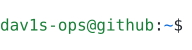
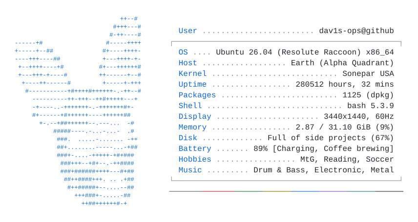

<picture><source media="(prefers-color-scheme: dark)" srcset="https://readme-typing-svg.demolab.com?font=Fira+Code&weight=300&size=16&pause=1000&color=F7F7F7&vCenter=true&repeat=false&width=300&height=50&lines=sudo+apt+update;sudo+apt+install+fastfetch;fastfetch"></picture>

<picture>
  <source media="(prefers-color-scheme: dark)" srcset="NeoFetchProfileGenerator/dark_mode.svg">
  
</picture>

<!-- 
 
   

   

   

      
      
   

   

   <h3><b>Fullstack Engineer</b> who ships production-grade apps!</h3>
   <ul>
      <li>💫 I like to build fast, scalable, and awesome web apps!</li>
      <li>🎛️ Former audio engineer & music producer → traded Ableton & Pro Tools for Visual Studio & VS Code</li>
      <li>📖 Learning new tech and understanding old patterns to improve UX/DX</li>
   </ul>

   <h4>Languages</h4>
   

   <h4>Technologies & Tools</h4>
   

   <h4>Dev Tools</h4>
   

   

   <picture>
      <source media="(prefers-color-scheme: light)" srcset="https://raw.githubusercontent.com/Dav1s-Ops/Dav1s-Ops/output/github-contribution-grid-snake.svg">
      <source media="(prefers-color-scheme: dark)" srcset="https://raw.githubusercontent.com/Dav1s-Ops/Dav1s-Ops/output/github-contribution-grid-snake-dark.svg">
      
   </picture>
-->
   

      
        
      
   

